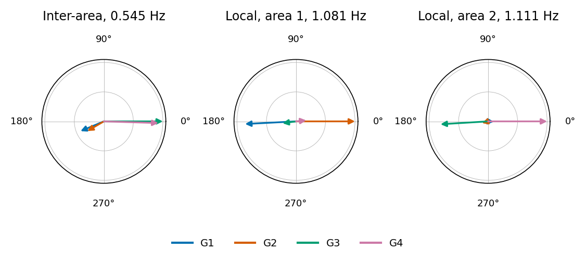
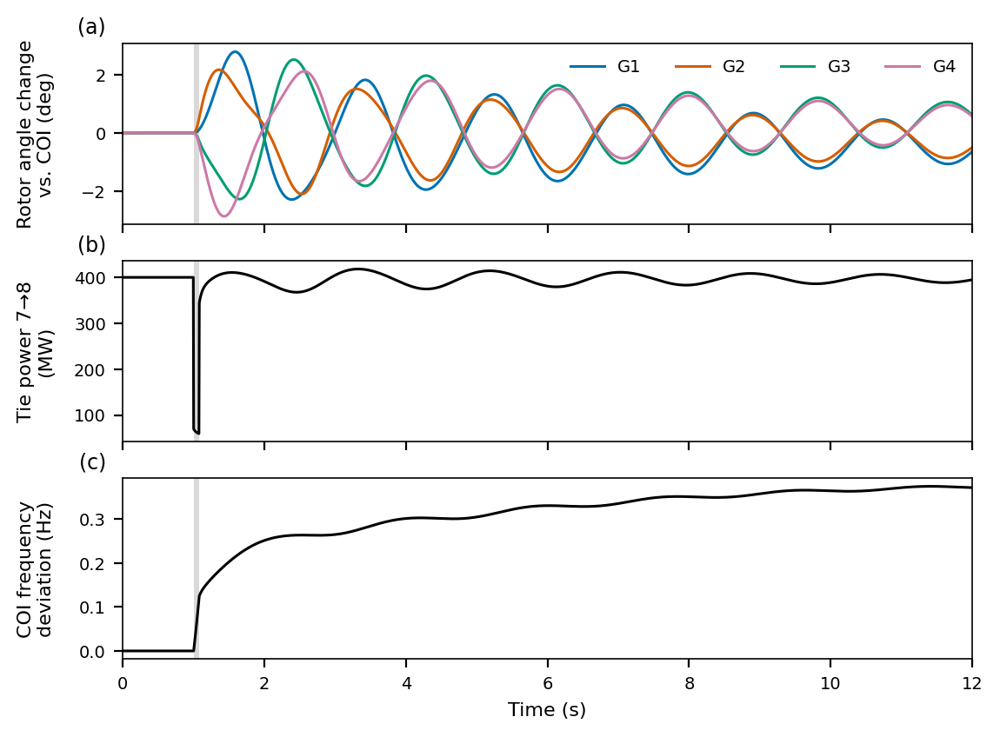
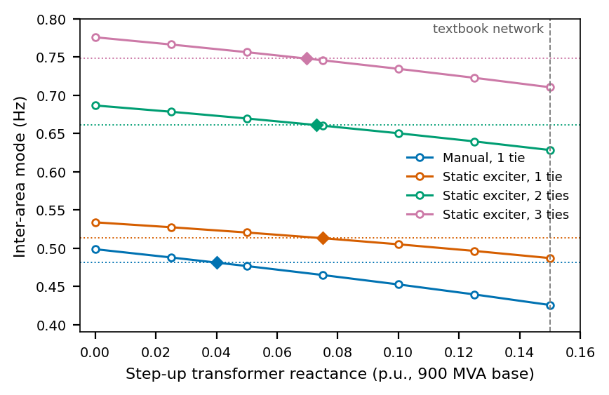

# Phase 1: Electromechanical modes of the Kundur two-area system

## Model

The two-area, four-machine system of Kundur [1, Example 12.6] is modelled in Python (`src/kundur_system.py`, `src/machines.py`) with the network, load and machine data of [1]: 11 buses, four 900 MVA units, two 110 km tie sections of two circuits each, loads of 967 + j100 MVA at bus 7 and 1767 + j100 MVA at bus 9, and 200 and 350 Mvar of shunt capacitors. G2, G3 and G4 generate 700, 719 and 700 MW and G1 is the slack bus. The power flow converges to a residual of 2.5 × 10⁻¹² p.u. with 400 MW flowing from area 1 to area 2.

Each unit is a six-state round-rotor model (δ, Δω, e′q, e′d and the two subtransient fluxes). Field voltage and mechanical torque are constant (manual excitation, no governor) and saturation is neglected. Active load is constant current, reactive load constant impedance; the network equations with these loads are solved by Newton's method at every evaluation of the state derivatives.

The state matrix A = ∂f/∂x is formed by central differences at the equilibrium (residual 1.7 × 10⁻¹²); halving the perturbation changes no eigenvalue by more than 10⁻⁹ s⁻¹. The rotor modes are the eigenvalues with 1 < Im λ < 12 rad/s. A mode is labelled inter-area when the difference between the two area averages of its normalized speed mode shape is larger than the difference between the two units of either area; otherwise it is local to the area with the larger internal difference.

## Modes

**Table 1.** Rotor modes, f (Hz) / ζ (%).

| Mode | This model, no saturation | Equivalent-circuit model, saturation as in [1] | [1], Table E12.3 |
|---|---|---|---|
| Inter-area | 0.5447 / 3.58 | 0.5454 / 3.23 | 0.545 / 3.2 |
| Local, area 1 | 1.0806 / 8.52 | 1.0873 / 7.18 | 1.087 / 7.2 |
| Local, area 2 | 1.1113 / 8.41 | 1.1175 / 7.19 | 1.117 / 7.2 |

**Fig. 1.** Speed mode shapes of the three rotor modes, normalized to the largest entry.

In the inter-area mode G1 and G2 swing together against G3 and G4; in each local mode the two units of one area swing against each other (Fig. 1). This agrees with the mode shapes in [1].

The frequencies agree with [1] within 0.6 %, but the local modes are about 1.3 percentage points better damped. The difference comes from saturation. Example 12.6 includes saturation ($A_\mathrm{sat}$ = 0.015, $B_\mathrm{sat}$ = 9.6, $\psi_{T1}$ = 0.9) and its small-signal analysis uses an equivalent-circuit machine model in which saturation is linearized with the incremental factor $1/(1 + B_\mathrm{sat}\psi_I)$ on both axes. Without saturation that model has the same eigenvalues as the six-state model (within 3 × 10⁻⁴ s⁻¹). With the saturation treatment of [1] (middle column of Table 1), the 22 nonzero eigenvalues of Table E12.3 are reproduced within 0.012 s⁻¹. The largest difference is in the area-1 mode, where the printed 6.82 rad/s is slightly below the 6.83 rad/s that corresponds to the printed 1.087 Hz. With the thyristor exciter of Table E12.4 ($K_A$ = 200, $T_R$ = 0.01 s) the inter-area mode becomes unstable, +0.030 ± j3.84 against +0.031 ± j3.84 in [1], and the case with transient gain reduction also agrees within 0.005 s⁻¹. With the PSS the differences are up to 0.10 s⁻¹, which I have not been able to explain yet.

Without saturation, the six-state model also has a slow real eigenvalue at +0.0049 s⁻¹ (time constant about 200 s), which has no visible effect within a 12 s simulation. With the saturation treatment of [1] all eigenvalues except the pair at the origin are in the left half-plane, as in [1].

As a check of the linearization, the nonlinear model started on the real part of each mode shape (amplitude 10⁻⁴) follows the linear prediction $\mathrm{Re}(v\,e^{\lambda t})$ over 5 s to within 0.5 % of the initial displacement.

## Fault response

A three-phase fault ($R_f$ = 10⁻⁴ p.u.) is applied at bus 8, in the middle of the tie, from 1.00 to 1.08 s. The equations are integrated with DOP853 (relative tolerance 10⁻⁸) and the integration is restarted at both switching instants. Before the fault the largest speed deviation is 3 × 10⁻¹³ Hz, which confirms that the initial state is an equilibrium.

**Fig. 2.** Fault at bus 8 from 1.00 to 1.08 s (shaded): (a) rotor angles relative to the centre of inertia (COI), (b) power from bus 7 to bus 8, (c) COI frequency deviation.

During the fault the bus-8 voltage falls to 0.0016 p.u. and the tie power from 400 MW to about 65 MW (Fig. 2). After clearing, the response is dominated by the 0.54 Hz inter-area swing, with the local modes visible in the first two seconds, and it decays slowly, in line with 3.6 % damping. Since there is no governor and no damping term, the energy imbalance during the fault is not corrected and the COI frequency ends 0.37 Hz above nominal; the rotor angles are therefore plotted relative to the COI.

## Comparison with Klein, Rogers and Kundur [2]

[2] gives no local-mode values, so only the inter-area mode can be compared. Its Table 2 gives 0.481 Hz and ζ = 0.023 for the symmetric system (1400 MW generation and 1367 MW constant-impedance load in each area, no transfer) with manual excitation and one tie circuit. Its Table 1 gives the same mode with static exciters ($K_A$ = 200, $T_R$ = 0.01 s, no transient gain reduction) for three, two and one tie circuits.

On the textbook network with one tie circuit and 200 Mvar per area, the symmetric case gives 0.4255 Hz and 4.47 %, which is 11.5 % below [2]. Varying the shunt compensation between 100 and 350 Mvar per area moves the frequency only within 0.415–0.441 Hz. One difference in the network data remains: Fig. 1 of [2] shows the units connected directly to the area buses and gives no transformer data, while the textbook network has 0.15 p.u. step-up transformers.

**Table 2.** Inter-area mode of the symmetric zero-transfer cases, f (Hz) / ζ (%).

| Excitation, tie circuits | [2] | Textbook network | No step-up transformers |
|---|---|---|---|
| Manual, 1 | 0.481 / 2.3 | 0.426 / 4.5 | 0.499 / 1.9 |
| Static, 1 | 0.513 / 0.2 | 0.487 / −0.8 | 0.534 / 0.7 |
| Static, 2 | 0.661 / 1.1 | 0.628 / −0.3 | 0.687 / 1.6 |
| Static, 3 | 0.748 / 1.8 | 0.710 / 0.1 | 0.776 / 2.2 |

**Fig. 3.** Inter-area mode of the four cases of Table 2 against the step-up transformer reactance. Dotted lines: values of [2]; diamonds: where each curve reaches them.

In all four cases the two networks bracket both the published frequency and the published damping ratio (Table 2). Fig. 3 sweeps the transformer reactance between the two: the published frequencies are reached at 0.070–0.075 p.u. with static exciters and at 0.040 p.u. with manual excitation. The connection impedance of the units, which [2] does not give, is therefore the most likely cause of the remaining difference. I have not fitted this reactance; an exact comparison needs the original input data of [2].

## Limitations

The model has no PSS and no governor, and no AVR except in the exciter cases above. For the partitioning work the network of [1] is the more practical reference because all its data are published; this choice should be agreed before the EMT model of the system is built.

## References

[1] P. Kundur, *Power System Stability and Control*. New York: McGraw-Hill, 1994.

[2] M. Klein, G. J. Rogers, and P. Kundur, "A fundamental study of inter-area oscillations in power systems," *IEEE Trans. Power Syst.*, vol. 6, no. 3, pp. 914–921, 1991.

Scripts: `src/phase1_modes.py` (Table 1 first column, Figs. 1–2), `src/phase1_textbook.py` (Table 1, comparison with [1]), `src/phase1_klein.py` (Table 2, Fig. 3).
