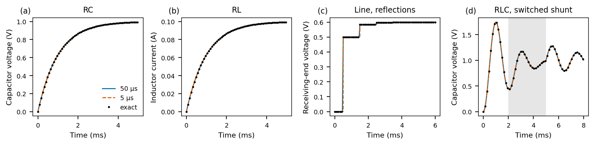
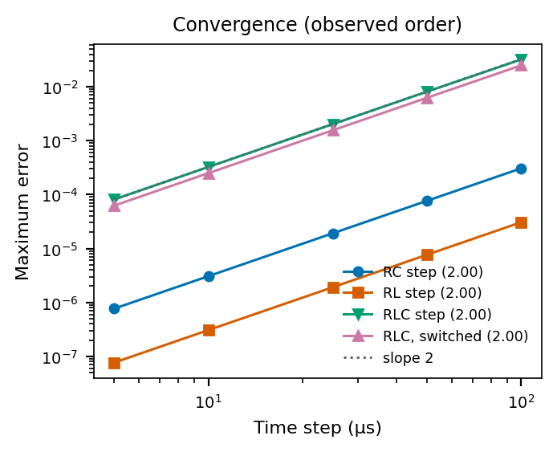

# Phase 2: Nodal EMT solver

Code: `src/emt.py` (solver), `src/phase2_validation.py` (test cases and figures).

## Method

The solver uses the nodal formulation with trapezoidal companion models [3]. Each inductor or capacitor is replaced by a conductance (Δt/2L or 2C/Δt) in parallel with a history current source that is updated after every step, so each step is one linear solve G v = i. Ideal voltage sources are nodes with a prescribed voltage whose contribution is moved to the right-hand side. A switch adds the conductance $1/R_\mathrm{on}$ when closed.

At a switching instant the step is first computed with the old topology. The same instant is then solved again with the new topology, holding the capacitor voltages and inductor currents, and the histories restart from these values. Without this second solve, the histories carry the pre-switching currents into the next step and the method drops to first order at every event: the switched test case below then has an error of 2.6 × 10⁻³ V at 5 µs instead of 6.2 × 10⁻⁵ V.

The lossless line uses the Bergeron model [3], [4]. With currents positive into the line at both ends,

$$i_k(t) = \frac{v_k(t)}{Z} + h_k(t), \qquad h_k(t) = -\frac{2\,v_m(t-\tau)}{Z} - h_m(t-\tau),$$

so each end is a conductance 1/Z with a current source that depends only on values at the other end one travel time earlier. The two ends are therefore decoupled within a step, which is what Phase 3 uses to split the network. The travel time must be a whole number of time steps (no interpolation).

## Validation

All cases are driven by a 1 V step at t = 0 and compared with analytic solutions.

| Case | Reference | Max. error, 50 µs | Max. error, 5 µs | Order |
|---|---|---|---|---|
| RC, 10 Ω, 100 µF | 1 − e^(−t/RC) | 7.7 × 10⁻⁵ V | 7.7 × 10⁻⁷ V | 2.00 |
| RL, 10 Ω, 10 mH | (1 − e^(−tR/L))/R | 7.7 × 10⁻⁶ A | 7.7 × 10⁻⁸ A | 2.00 |
| Series RLC, 6 Ω, 10 mH, 10 µF | closed form (underdamped) | 8.1 × 10⁻³ V | 8.1 × 10⁻⁵ V | 2.00 |
| Same RLC, 100 Ω across C closed at 2 ms, opened at 5 ms | matrix exponential per interval | 6.2 × 10⁻³ V | 6.2 × 10⁻⁵ V | 2.00 |
| Line, Z = 50 Ω, τ = 0.5 ms, source 100 Ω, load 150 Ω | lattice diagram | 2.2 × 10⁻¹⁶ V | 2.2 × 10⁻¹⁶ V | exact |

The order is fitted over 100, 50, 25, 10 and 5 µs. In addition:

- In the switched case the capacitor voltage and inductor current are exactly continuous across both events.
- For an undamped LC circuit the stored energy stays constant to 6 × 10⁻¹³ (relative) over 4000 steps, as expected for the trapezoidal rule.

**Fig. 1.** Computed responses at 50 µs and 5 µs against the analytic solutions: (a) RC, (b) RL, (c) receiving-end voltage of the mismatched line, with reflections at 0.5, 1.5 and 2.5 ms, (d) RLC with the switched shunt (shaded interval).

**Fig. 2.** Maximum error against time step; the fitted order is given in brackets.

The errors drop by a factor of 100 from 50 µs to 5 µs, as expected for a second-order method. The line result is exact at both steps: the Bergeron model of a lossless line has no truncation error when τ is a multiple of Δt, so all line errors in Phase 3 come from the interface, not from the line model.

## Limitations

Fixed time step; switching only at step boundaries; travel times rounded to whole steps; lossless, single-phase lines only. Interrupting an inductor current (an inductor in series with an opening switch) is not supported, and the numerical oscillations of the trapezoidal rule in that case are not damped.

## References

[3] H. W. Dommel, "Digital computer solution of electromagnetic transients in single- and multiphase networks," *IEEE Trans. Power App. Syst.*, vol. PAS-88, no. 4, pp. 388–399, 1969.

[4] N. Watson and J. Arrillaga, *Power Systems Electromagnetic Transients Simulation*, 2nd ed. London: IET, 2018.
