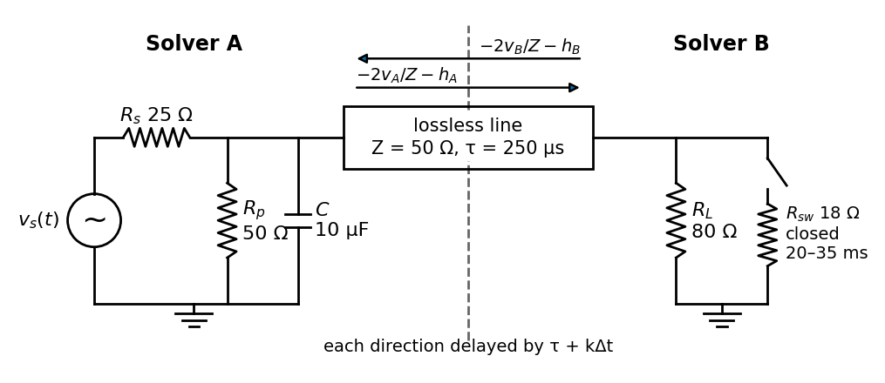
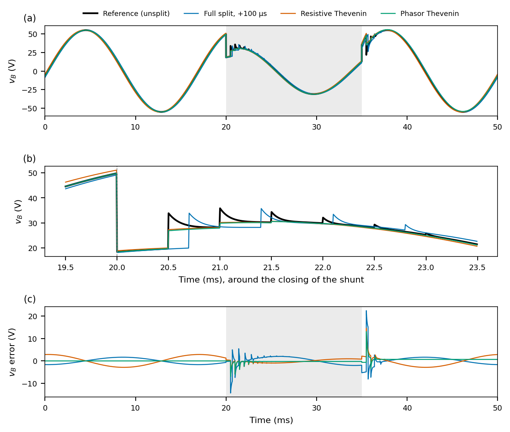
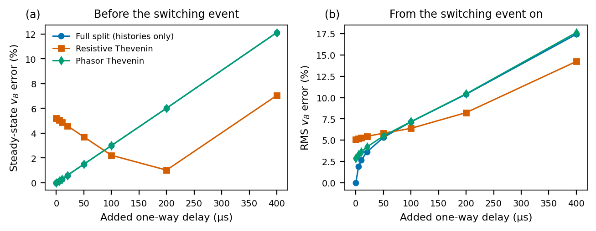
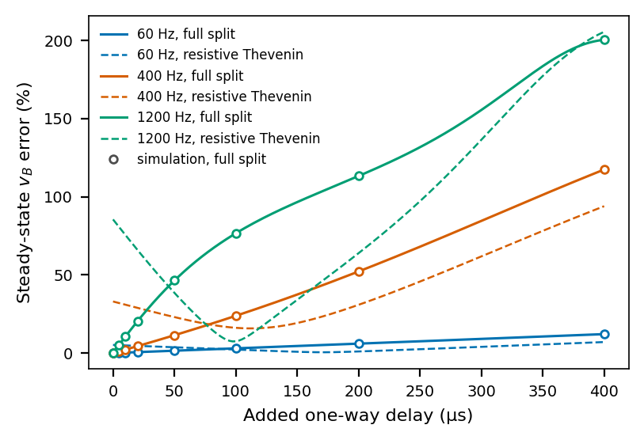

# Phase 3: Splitting at a Bergeron line, interface delay and Thevenin equivalents

## Set-up

The Phase 2 test circuit is split at its transmission line into two solvers (Fig. 1). Side A contains the source (100 V peak, 60 Hz unless stated otherwise) behind $R_s$ = 25 Ω and a shunt $R_p$ = 50 Ω ∥ $C$ = 10 µF; side B contains an 80 Ω load and an 18 Ω shunt that closes at 20 ms and opens at 35 ms. The line is lossless with Z = 50 Ω and τ = 250 µs; the time step is Δt = 5 µs, so τ = 50 steps.

**Fig. 1.** Test circuit and partition. Each solver sends one number per step to the other.

The interface is defined as follows:

| Item | Definition |
|---|---|
| Exchanged value | outgoing history −2v/Z − h of each line end, one value per direction and step |
| Sign convention | currents positive into the line at both ends, i = v/Z + h |
| Timing | the value produced at step n is used by the other solver at step n + τ/Δt + k, where k is the added delay in steps |
| Order within a step | read the incoming history, solve the local network, send the outgoing history |
| Start | histories and capacitor states of the sinusoidal steady state |

Every run starts from its own steady state with the switch open. It is computed from the phasor solution of the discretized circuit (trapezoidal frequency warping for the capacitors, exact delay for the line), so the waveforms before 20 ms are exact sinusoids (the fitted phasors match the prediction within 7 × 10⁻¹¹ V). The error before 20 ms is therefore a pure steady-state error, and the switching event shows the transient error. Errors are given for the receiving-end voltage $v_B$ against the unsplit solution: the steady-state error is $|\Delta V_B|/|V_B|$ from the fitted phasors, the transient error is the relative RMS error from 20 ms to the end of the run (50 ms). The same metrics for the line current, and all values for 400 and 1200 Hz, are in `results/phase3_errors.csv`.

## Results

**Split without added delay.** The split and unsplit solutions agree to 2 × 10⁻¹⁴ V. This is expected: because τ ≥ Δt, the line already decouples the two nodal equations, so cutting there involves no approximation. In a real-time setting the travel time is also a latency budget. The history used at step n was produced at step n − 50, so a communication delay of up to τ − Δt ≈ 245 µs (one step is needed for computing) costs no accuracy.

**Added delay.** Delaying the histories by k more steps is the same as simulating a line that is kΔt longer. The coupled simulation therefore stays passive and stable for any k (unlike voltage–current interfaces [9]), but the result is wrong (Figs. 2 and 3):

- In steady state the error grows almost linearly with the delay: 0.15 % per step, 3.0 % at 100 µs and 12 % at 400 µs at 60 Hz. It scales with $\omega k\Delta t$ (Fig. 4): at 100 µs it is 24 % at 400 Hz and 77 % at 1200 Hz, close to the $2\sin(\omega k\Delta t/2)$ of a pure time shift (3.8 %, 25 % and 74 %). The admissible delay is thus set by the highest frequency the study must reproduce.
- After the switching event the reflections between the two line ends arrive 2kΔt later in every round trip (Fig. 2b). One step of delay already gives a transient error of 1.9 %, against 0.15 % in steady state, and 100 µs gives 7.2 %. The maximum pointwise error is not a useful measure here: with one step of delay it is 27 V, the height of a wavefront that arrives one sample late.

**Fig. 2.** Receiving-end voltage at 60 Hz: (a) full run, shunt closed in the shaded interval; (b) the first reflections after the shunt closes; (c) difference from the unsplit solution.

**Thevenin equivalents of side A.** In the second variant side A is replaced by a Thevenin equivalent seen from the line end, computed for the source frequency:

- Resistive: $e(t) = R_p/(R_s + R_p)\, v_s(t)$ behind $R_s \parallel R_p$ = 16.7 Ω, i.e. without C.
- Phasor: $Z_\mathrm{th} = 1/(1/R_s + 1/R_p + j\omega C)$ = 16.60 − j1.04 Ω at 60 Hz, realized as 16.60 Ω in series with 2543 µF, behind $e(t) = 0.665\, v_s(t)$ shifted by −3.6°.

**Table 1.** Errors of $v_B$ at 60 Hz (%), for 0 / 100 / 400 µs of added delay.

| Variant | Steady state | After the switching event |
|---|---|---|
| Full split | 0 / 3.0 / 12.1 | 0 / 7.2 / 17.4 |
| Resistive Thevenin | 5.2 / 2.2 / 7.0 | 5.1 / 6.4 / 14.2 |
| Phasor Thevenin | 0.0 / 3.0 / 12.1 | 2.9 / 7.2 / 17.6 |

**Fig. 3.** Error of $v_B$ at 60 Hz against the added delay: (a) steady state, (b) from the switching event on.

The resistive equivalent has a steady-state error of 5.2 % without any delay (33 % at 400 Hz, 85 % at 1200 Hz). With delay this error first decreases, to 1.0 % at 200 µs, because the phase lag of the delay partly cancels the phase error of the equivalent (Fig. 3a, Fig. 4). The cancellation depends on frequency and is not a property of the interface.

The phasor equivalent is exact in steady state at the source frequency (10⁻⁶ % from the discretization), so with delay its steady-state error is the same as that of the full split. It is wrong during transients: 2.9 % without delay (4.4 % at 400 Hz). It does not reproduce the reflections at side A, which acts as a short circuit for steep wavefronts because of C, while the equivalent presents 16.6 Ω (Fig. 2b). After each event its series capacitor also keeps a DC offset that decays with $(R_\mathrm{th} + R_L)\,C_\mathrm{th}$ ≈ 0.25 s, visible in Fig. 2c after 35 ms.

Model error and delay error do not simply add. For the resistive equivalent at 100 µs, the error from the equivalent alone is 5.1 % and the error from the delay alone (against the same equivalent without delay) is 5.5 %, but the total is 6.4 %. The study therefore records all three: total, delay only and model only.

**Fig. 4.** Steady-state error of $v_B$ against the added delay at 60, 400 and 1200 Hz. Lines: phasor solution of the continuous circuit; circles: simulation.

## Conclusions

1. Cutting at a line is exact as long as the communication delay is shorter than the travel time of the line minus one step.
2. Delay beyond that acts like extra line length: the simulation stays stable, but the error grows roughly with ω times the delay in steady state, and every reflection is shifted in transients.
3. A fundamental-frequency equivalent is exact in steady state only; a resistive equivalent is wrong even in steady state, and with delay its error can look smaller by cancellation. For transient studies the equivalent needs the frequency dependence of the replaced network, for example a rational fit by vector fitting [10].

## Proposal: the same study on the Kundur two-area system

- **Model.** EMT model of the 11-bus system of Phase 1, starting single-phase (balanced) and then three-phase, with the six-state machines connected through their stator equations and the two 110 km sections as Bergeron lines (travel time about 386 µs). Time step 50 µs, so τ ≈ 8 steps; reference without splitting.
- **Cut.** At bus 8, the middle of the tie, so that each area with one tie section forms a subsystem and only line histories cross the interface. Delay sweep from 0 to about 1 ms beyond τ.
- **Equivalents for area 2.** (a) Full model; (b) 60 Hz Thevenin equivalent at bus 8; (c) frequency-dependent network equivalent of area 2 fitted by vector fitting [10], with the machines first held at constant EMF and then represented by one aggregated machine.
- **Disturbance and metrics.** The bus-8 fault of Phase 1. EMT metrics: RMS error of the bus 7 and 9 voltages and of the tie currents during the fault and the first cycles after clearing. Electromechanical metrics: frequency and damping of the inter-area mode estimated from the tie power (Prony or eigensystem realization), and the first rotor-angle swing, compared with the values of Phase 1.
- **Result.** For each metric, the largest delay that keeps the error below an agreed limit, for example 0.1 percentage points of inter-area damping, and the same comparison for the three equivalents.

## References

[9] W. Ren, M. Steurer, and T. L. Baldwin, "Improve the stability and the accuracy of power hardware-in-the-loop simulation by selecting appropriate interface algorithms," *IEEE Trans. Ind. Appl.*, vol. 44, no. 4, pp. 1286–1294, 2008.

[10] B. Gustavsen and A. Semlyen, "Rational approximation of frequency domain responses by vector fitting," *IEEE Trans. Power Del.*, vol. 14, no. 3, pp. 1052–1061, 1999.

Script: `src/phase3_partition.py`.
