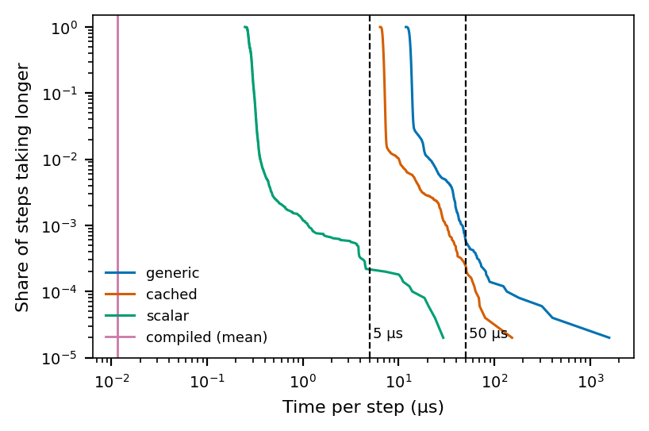

# Phase 4: Per-step cost of the Python solver, and questions for January

This phase follows the profiling option of the plan. The Phase 3 circuit is run as two solvers coupled by the Bergeron line (60 Hz source, Δt = 5 µs, 10 000 steps including both switching events), and every step is timed with `time.perf_counter_ns`, over five repetitions. Four implementations of the same computation are compared; they give the same waveform within 1.4 × 10⁻¹³ V.

- **generic:** `emt.Circuit` for each subsystem, `np.linalg.solve` in every step.
- **cached:** the same objects, with the inverse matrix of each switch state computed once.
- **scalar:** the two one-node subsystems written out with Python floats.
- **compiled:** the scalar loop compiled with numba; only the mean time per step can be measured.

**Table 1.** Time per step (µs) and share of steps longer than the step budget.

| Implementation | Median | 99th percentile | Maximum | > 5 µs | > 50 µs |
|---|---|---|---|---|---|
| generic | 13.3 | 20.9 | 1582 | 100 % | 0.06 % |
| cached | 6.9 | 10.1 | 153 | 100 % | 0.02 % |
| scalar | 0.28 | 0.36 | 29 | 0.02 % | 0 |
| compiled | 0.012 (mean) | – | – | – | – |

**Fig. 1.** Share of steps that take longer than a given time. Dashed lines: 5 µs and 50 µs step budgets.

## What limits real-time execution

- **Overhead, not arithmetic.** One step of this circuit needs a few tens of floating-point operations, and compiled it takes 12 ns. The generic solver takes about 1000 times longer. In the profile (`results/phase4_profile.txt`), `np.linalg.solve` takes 55 % of the run time, mostly argument checking and dispatch for a 1 × 1 system, and the Python loops in `Circuit.step` most of the rest.
- **Caching helps, but not enough.** Reusing one factorization per switch state halves the median, but every step still misses a 5 µs budget. Writing the update out with scalars brings the median to 0.28 µs.
- **The tail matters more than the median.** Even the scalar loop has steps of up to 29 µs, and in the generic solver single steps reach 1.6 ms (garbage collection and operating-system scheduling); the maxima change from run to run. A fixed-step real-time simulator needs a bound on the worst case, which an interpreted language on a general-purpose operating system cannot give. Compiled code on isolated cores, or an FPGA with a fixed schedule [12], is needed.
- **Scaling.** For larger subsystems the arithmetic per step grows with the network size (sparse solve and history updates). With a fixed set of switch states the factorizations can be prepared in advance, as the cached version does, which leaves forward and backward substitution in each step.

## Questions and ideas for the first week

1. **Time step and budget.** What step is targeted for the prototype (50 µs for the Kundur system, a few µs for converter models), and how is the step budget divided between solving, interface exchange and I/O on the lab platforms?
2. **Latency budget of a cut.** Phase 3 shows that a cut at a line is exact if the communication delay stays below the travel time minus one step; for a 110 km section of the Kundur tie the travel time is about 0.39 ms. Which lines in the target systems are long enough for the expected network latency, and how should a cut be made where there is no such line?
3. **Contents of a message.** Besides the history values, should each message carry a time stamp and sequence number, so that late or lost values are detected? What should a solver do with a late value: hold the last one, extrapolate, or stop?
4. **Equivalents.** For the remote area, is a frequency-dependent network equivalent from vector fitting [10] plus aggregated machines the intended direction? How is passivity of the fitted equivalent checked and enforced?
5. **Accuracy metrics.** Which errors matter to the industry partners: waveform RMS error, protection quantities such as peak fault current and detection time, or electromechanical quantities such as the damping of the inter-area mode?
6. **FPGA arithmetic.** What word length and scaling are needed for the history terms and node voltages, given their range during faults? Is the FPGA solver generated per network with HLS [13] or a programmable solver engine as in [12]?
7. **Reference system.** Should the prototype use the network of Kundur's Example 12.6, for which all data are published, or the network of Klein et al. (Phase 1)?

## References

[10] B. Gustavsen and A. Semlyen, "Rational approximation of frequency domain responses by vector fitting," *IEEE Trans. Power Del.*, vol. 14, no. 3, pp. 1052–1061, 1999.

[12] Y. Chen and V. Dinavahi, "FPGA-based real-time EMTP," *IEEE Trans. Power Del.*, vol. 24, no. 2, pp. 892–902, 2009.

[13] AMD, *Vitis High-Level Synthesis User Guide* (UG1399).

Script: `src/phase4_profile.py` (timings depend on the machine; these were measured on an x86-64 machine with Python 3.12 and NumPy 2.3).
